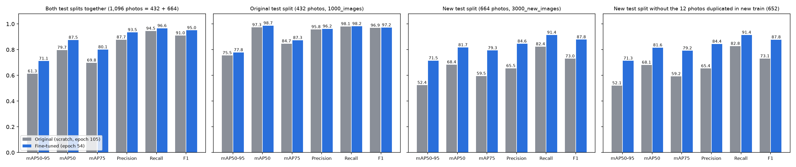
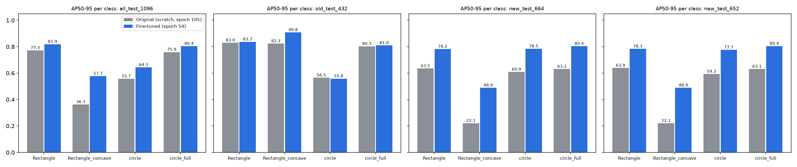
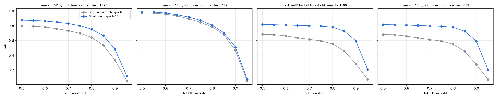
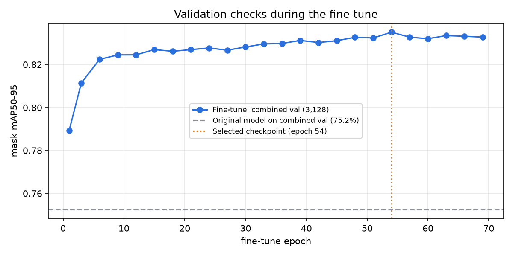
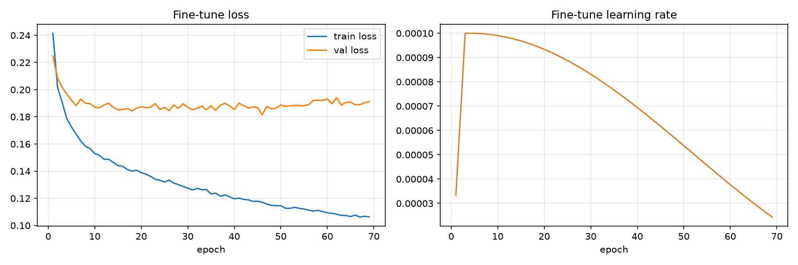

# Model V7, fine-tuned on new photos

The original Model V7 was trained from scratch on the `1000_images` photos (see the
[main README](../README.md)). On a new set of photos (`3000_new_images`) it scored only
52.4 % mask mAP50-95. This folder holds the **fine-tuned model**: the same network, trained
further on the original and the new photos together, and a full comparison of the two.

**In short:** over all 1,096 test photos, mask mAP50-95 rose from 61.3 % to 71.1 % and F1 from
91.0 % to 95.0 %. On new photos it rose from 52.4 % to 71.5 %. It did not forget the original
photos; it scored better there too (75.5 % → 77.8 %).

- [Overall performance](#overall-performance-all-1096-test-photos-together) ·
  [1. Result per test set](#1-result-per-test-set)
- [2. How the comparison was made](#2-how-the-comparison-was-made)
- [3. Test metrics per test set](#3-test-metrics-per-test-set) · [4. Per class](#4-per-class) ·
  [5. Mask quality](#5-mask-quality-map-at-each-iou-threshold) ·
  [6. Semantic segmentation](#6-semantic-segmentation-per-pixel) · [7. Validation](#7-validation)
- [8. What the fine-tune changed](#8-what-the-fine-tune-changed) ·
  [9. Remaining weaknesses](#9-remaining-weaknesses-of-the-fine-tuned-model)
- [10. Use the fine-tuned model](#10-use-the-fine-tuned-model) ·
  [11. Repeat the fine-tune](#11-repeat-the-fine-tune) · [12. Files](#12-files-in-this-folder)

| | Original (from scratch) | Fine-tuned |
|---|---|---|
| Run folder (WSL) | `~/Models/Model_v7_scratch_rtx` | `~/Models/Model_v7_finetune_new3000` |
| Model file | `best_model_v7_instance.keras` (sha256 `3e081ad9…`) | `best_fine_tuned_model_v7_instance.keras` (sha256 `872f9bc0…`; the copy in `model/` has no optimizer state: `44ca427f…`) |
| Selected checkpoint | epoch 105 of 120 | epoch 54 (early stop after epoch 69) |
| Starts from | random weights | the original model (epoch 105) |
| Training data | original 1000_images train split | original train + 3000_new_images train split |
| Training period | 2026-09-11 to 2026-09-14 | 2026-09-29 14:37 to 2026-10-06 ~02:15 |
| Parameters | 6,343,486 | 6,343,486 (same architecture) |

## Overall performance (all 1,096 test photos together)

Both test splits pooled into one test set (432 original + 664 new photos), scored in one
evaluation per model ([`eval_all_test_compare.py`](../eval_all_test_compare.py)). This is the single number for
"how good is the model overall". It is computed directly, not averaged from the separate
results, because mAP cannot be averaged across test sets.

| Metric (1,096 photos, 43,384 labelled objects) | Original | Fine-tuned | Change |
|---|---|---|---|
| **mask mAP50-95** | 61.3 % | **71.1 %** | **+9.8** |
| mask mAP50 | 79.7 % | **87.5 %** | +7.8 |
| mask mAP75 | 69.8 % | **80.1 %** | +10.3 |
| Precision (IoU 0.5) | 87.7 % | **93.5 %** | +5.7 |
| Recall (IoU 0.5) | 94.5 % | **96.6 %** | +2.1 |
| **F1 (IoU 0.5)** | 91.0 % | **95.0 %** | **+4.0** |
| Correct detections (TP) | 41,006 | 41,927 | +921 |
| False detections (FP) | 5,735 | 2,931 | −49 % |
| Missed objects (FN) | 2,378 | 1,457 | −39 % |
| Semantic foreground mIoU (per pixel) | 65.5 % | **80.1 %** | +14.6 |
| Pixel accuracy | 96.2 % | 98.0 % | +1.8 |

Per class (AP50-95, all 1,096 photos):

| Class | Objects | Original | Fine-tuned | Change |
|---|---|---|---|---|
| Rectangle | 20,056 | 77.3 % | **81.9 %** | +4.6 |
| Rectangle_concave | 548 | 36.3 % | **57.7 %** | +21.4 |
| circle | 4,660 | 55.7 % | **64.3 %** | +8.6 |
| circle_full | 18,120 | 75.9 % | **80.4 %** | +4.5 |

mAP at each IoU threshold (all 1,096 photos):

| IoU | 0.50 | 0.60 | 0.70 | 0.75 | 0.80 | 0.85 | 0.90 | 0.95 |
|---|---|---|---|---|---|---|---|---|
| Original | 79.7 | 78.2 | 73.3 | 69.8 | 64.2 | 53.6 | 33.2 | 5.7 |
| Fine-tuned | 87.5 | 86.4 | 82.9 | 80.1 | 75.3 | 66.6 | 48.0 | 12.0 |

**Verdict:** the fine-tuned model is better overall on every overall metric, on every class, and
at every IoU threshold. It makes about half as many false detections and misses 39 % fewer
objects. The pooled TP and FN counts equal the sums of the two separate test runs exactly; the
FP counts differ by 7 (original) and 4 (fine-tuned) from those sums.

## 1. Result per test set

| Test set | Metric | Original | Fine-tuned | Change |
|---|---|---|---|---|
| **Original test, 432 photos** | mask mAP50-95 | 75.5 % | **77.8 %** | +2.3 |
| | F1 at IoU 0.5 | 96.9 % | 97.2 % | +0.3 |
| **New test, 664 photos** | mask mAP50-95 | 52.4 % | **71.5 %** | +19.1 |
| | F1 at IoU 0.5 | 73.0 % | 87.9 % | +14.9 |
| **New test without duplicates, 652** | mask mAP50-95 | 52.1 % | **71.3 %** | +19.2 |
| | F1 at IoU 0.5 | 73.1 % | 87.8 % | +14.7 |

- The fine-tune fixed the large drop on the new photos (+19 points mAP50-95).
- It did **not** forget the original data: on the original test split, which it never
  trained on, it is also better (+2.3 points). That evaluation was run on 2026-10-12 for this
  comparison; the original model reproduced its documented 75.5 % exactly in the same run.



## 2. How the comparison was made

- **Same code path for both models:** `model_v7.evaluate("test")`, the function that produced the
  original's published numbers, with identical decoder thresholds, run for both models in one
  session per test set.
  - Original test: [`eval_old_test_compare.py`](../eval_old_test_compare.py).
  - New test: [`eval_new_test_compare.py`](../eval_new_test_compare.py).
- **Test sets:**
  - *Original test (432)*: the untouched test split of `1000_images` (arrays
    `~/data/pcb_v62_arrays_repaired`). Neither model trained on it.
  - *New test (664)*: the test split of `3000_new_images` (arrays `~/data/pcb_v7_new3000_arrays`).
    Neither model trained on it, but 12 of its photos also appear in the new train split
    (found by board-thumbnail correlation ≥ 0.99 and mean pixel difference < 3; list in
    `results/raw/test/new_test_test_duplicates_in_new_train.json`). They were kept in the test split.
  - *New test without duplicates (652)*: the same split with those 12 removed, the cleanest
    measure for the fine-tuned model.
- **Metrics:** mask mAP over IoU 0.50–0.95 (101-point interpolation, up to 300 detections per
  image, confidence = mean class probability over the instance); precision, recall and F1 by
  one-to-one same-class mask matching at IoU 0.50; semantic metrics per pixel.

## 3. Test metrics per test set

| Test set | Model | mAP50-95 | mAP50 | mAP75 | Precision | Recall | F1 | TP | FP | FN |
|---|---|---|---|---|---|---|---|---|---|---|
| Original 432 | Original | 75.54 | 97.31 | 84.70 | 95.77 | 98.10 | 96.92 | 32,852 | 1,450 | 636 |
| Original 432 | Fine-tuned | **77.81** | **98.70** | **87.32** | **96.24** | **98.19** | **97.20** | 32,882 | 1,286 | 606 |
| New 664 | Original | 52.40 | 68.37 | 59.49 | 65.52 | 82.40 | 72.99 | 8,154 | 4,292 | 1,742 |
| New 664 | Fine-tuned | **71.50** | **81.70** | **79.35** | **84.58** | **91.39** | **87.85** | 9,044 | 1,649 | 852 |
| New 652 | Original | 52.09 | 68.14 | 59.25 | 65.38 | 82.78 | 73.06 | 8,033 | 4,254 | 1,671 |
| New 652 | Fine-tuned | **71.33** | **81.59** | **79.23** | **84.43** | **91.42** | **87.78** | 8,871 | 1,636 | 833 |

On the new test, false detections fell from 4,292 to 1,649 (−62 %) and missed objects from
1,742 to 852 (−51 %).

## 4. Per class

AP50-95 per class:



| Test set | Class | Targets | Original AP50-95 | Fine-tuned AP50-95 | Original P / R | Fine-tuned P / R |
|---|---|---|---|---|---|---|
| Original 432 | Rectangle | 15,156 | 83.00 | **83.68** | 94.2 / 98.2 | 94.3 / 98.2 |
| Original 432 | Rectangle_concave | 108 | 82.35 | **90.79** | 50.3 / 91.7 | 59.3 / **100.0** |
| Original 432 | circle | 3,272 | **56.48** | 55.81 | 97.3 / **98.0** | 98.0 / 96.0 |
| Original 432 | circle_full | 14,952 | 80.32 | **80.95** | 97.7 / 98.1 | 98.4 / 98.7 |
| New 664 | Rectangle | 4,900 | 63.51 | **78.23** | 69.1 / 80.0 | 85.9 / 93.6 |
| New 664 | Rectangle_concave | 440 | 22.05 | **48.89** | 16.2 / 26.8 | 52.4 / 37.5 |
| New 664 | circle | 1,388 | 60.92 | **78.48** | 42.8 / 76.6 | 75.9 / 83.9 |
| New 664 | circle_full | 3,168 | 63.10 | **80.41** | 85.8 / 96.4 | 89.3 / 98.7 |

- **Rectangle_concave** gained most (+26.8 on the new test, +8.4 on the original test) but is
  still the weakest class on the new photos: it finds only 37.5 % of them.
- **circle on the original test** is the only place the fine-tuned model is slightly worse:
  AP50-95 −0.7 and recall 98.0 → 96.0 % (missed circles 67 → 130). Precision went up
  (97.3 → 98.0 %), so it became a little more cautious on that class.
- The 652-image scope gives the same per-class picture (`results/tables/per_class_test.csv`).

## 5. Mask quality (mAP at each IoU threshold)



| IoU | 0.50 | 0.60 | 0.70 | 0.75 | 0.80 | 0.85 | 0.90 | 0.95 |
|---|---|---|---|---|---|---|---|---|
| Original 432 – original | 97.3 | 95.8 | 89.4 | 84.7 | 78.4 | 68.0 | 46.4 | 5.1 |
| Original 432 – fine-tuned | 98.7 | 97.4 | 91.7 | 87.3 | 80.6 | 70.7 | 51.0 | 7.3 |
| New 664 – original | 68.4 | 66.2 | 61.5 | 59.5 | 55.3 | 45.7 | 28.3 | 7.4 |
| New 664 – fine-tuned | 81.7 | 81.1 | 80.0 | 79.4 | 78.1 | 72.8 | 59.4 | 20.7 |

The fine-tuned masks are tighter at every threshold. On the new test the gain grows with the
threshold (+13 points at IoU 0.50, +31 at 0.90), so the fine-tune improved mask outlines, not only
detection.

## 6. Semantic segmentation (per pixel)

| Test set | Model | Pixel accuracy | Foreground mIoU | Foreground Dice |
|---|---|---|---|---|
| Original 432 | Original | 98.34 | 84.22 | 91.36 |
| Original 432 | Fine-tuned | 98.35 | 84.18 | 91.29 |
| New 664 | Original | 94.86 | 58.19 | 72.61 |
| New 664 | Fine-tuned | **97.80** | **77.28** | **86.99** |

Per pixel, the original data is unchanged (±0.1), and the new data improves by 19 points of
foreground mIoU. Per class: `results/tables/semantic_per_class_test.csv`.

## 7. Validation

| Validation set | Model | mAP50-95 | mAP50 | F1 |
|---|---|---|---|---|
| Original val (1,048) | Original | 85.15 | 98.74 | 97.17 |
| Combined val (3,128 = 1,048 original + 2,080 new) | Original | 75.24 | 91.16 | 87.55 |
| Combined val (3,128) | Fine-tuned | **83.50** | **95.71** | **95.42** |

The combined validation set was also used to pick the fine-tuned checkpoint, so its gain
(+8.3) is slightly optimistic; the test sets above are the unbiased comparison.



The fine-tune reached 78.9 % at its first check (epoch 1) and 82.2 % by epoch 6. It then rose
slowly to its best, 83.5 % at epoch 54. The next five checks (epochs 57–69) did not beat it,
so early stopping ended the run after epoch 69. Final model selection compared four
candidates on the combined validation set (`results/raw/training/finetuned/final_model_selection.json`):

| Rank | Candidate | mAP50-95 | F1 |
|---|---|---|---|
| 1 | best_fine_tuned_instance (epoch 54), **selected** | 83.50 | 95.42 |
| 2 | best_fine_tuned_semantic (epoch 48) | 83.27 | 95.36 |
| 3 | last_fine_tuned (epoch 69) | 83.27 | 95.33 |
| 4 | the original model | 75.24 | 87.55 |

The semantic-best checkpoint scored 71.9 % on the new test (71.7 % on 652), marginally above
the selected one; it was not chosen because selection is by validation, not test.



## 8. What the fine-tune changed

Full list: `results/tables/training_config_differences.csv`.

| Setting | Original run | Fine-tune |
|---|---|---|
| Start weights | random | original model, epoch 105 |
| Training data (array rows) | 4,680 | 15,840 (4,680 original + 11,160 new) |
| Validation data | 1,048 | 3,128 (1,048 original + 2,080 new) |
| Epochs (max) | 120 | 100, early stop at 69 |
| Peak learning rate | 3e-4 | 1e-4 (cosine to 1e-6) |
| Warm-up epochs | 6 | 3 |
| Weight decay | 1e-4 | 5e-5 |
| Exact rotation angles | 1°, 3°, …, 89° | 2°, 4°, …, 90° |
| Mirror-side augmentation | off | on, p = 0.25, left/top alternating by epoch |
| Semantic class weights | 1.00 / 3.44 / 7.74 / 6.10 / 4.64 | 1.00 / 3.42 / 8.00 / 6.12 / 6.80 |
| Validation checks | every 5 epochs, 256-image subset | every 3 epochs, full 3,128 images |
| Early stopping | none | 5 checks without improvement |

## 9. Remaining weaknesses of the fine-tuned model

- **Rectangle_concave on new photos**: AP50-95 48.9 %, recall 37.5 %, so most are missed or
  called Rectangle.
- **High-IoU masks**: mAP at IoU 0.95 is 20.7 % (new) and 7.3 % (original). A one-pixel boundary
  error already costs a lot at 512 × 512.
- An error review of the 664 new test photos found 540
  wrong-class objects (mostly Rectangle_concave predicted as Rectangle), 1,108 false detections
  (537 with no overlapping label, possibly unlabelled pads) and 311 missed objects.

## 10. Use the fine-tuned model

The model is in this folder: [`model/best_fine_tuned_model_v7_instance.keras`](model/best_fine_tuned_model_v7_instance.keras)
(27 MB). It holds the epoch-54 weights without the optimizer's training state, which
prediction does not need; the weights are identical to the training run's 231 MB file.

Use it exactly like the original model (see [Use the trained model](../README.md#use-the-trained-model)
in the main README); only the file changes:

```python
model_file = Path("fine_tune/model/best_fine_tuned_model_v7_instance.keras")
model = tf.keras.models.load_model(model_file, compile=False)
result = m.predict_one_image(model, Path("board.png"), Path("output/board"))
```

## 11. Repeat the fine-tune

1. Prepare the `3000_new_images` arrays with `./run.sh prepare` (`PCB_DATASET_ROOT` pointing to
   its `split_data`, `PCB_ARRAY_DIR` to a new folder).
2. Combine them with the original arrays: [`build_combined_arrays.py`](../build_combined_arrays.py)
   (train = original + new train, val = original + new val, test = new test).
3. Start the fine-tune from the original model:

   ```bash
   export PCB_ARRAY_DIR=~/data/pcb_v7_combined_arrays
   export PCB_MODEL_OUTPUT_DIR=~/Models/Model_v7_finetune_new3000
   export PCB_FINE_TUNE_SOURCE=~/Models/Model_v7_scratch_rtx/best_model_v7_instance.keras
   ./session.sh start finetune      # or: ./run.sh finetune
   ```

   The settings are in `apply_fine_tune_configuration` in [`train_v7.py`](../train_v7.py).
   It took about 6.5 days on an 8 GB laptop GPU (about 2.1 h per epoch including the
   validation checks).
4. Score both models: `eval_old_test_compare.py`, `eval_new_test_compare.py` and, for both test
   sets together, `eval_all_test_compare.py`.

Note: `model_v7.py` in this repository is the version the fine-tune used: exact rotations
2°, 4°, …, 90° and mirror-side augmentation on. The original scratch run used rotations
1°, 3°, …, 89° and no mirror augmentation (its settings are in
[`results/training/training_config.json`](../results/training/training_config.json)).

## 12. Files in this folder

| Path | Contents |
|---|---|
| `model/best_fine_tuned_model_v7_instance.keras` | the fine-tuned model (epoch 54, 27 MB) |
| `results/tables/overall_test.csv` | overall and Section 3, all four test scopes |
| `results/tables/per_class_test.csv` | per class: targets, predictions, TP/FP/FN, P/R/F1, AP50/AP75/AP50-95 |
| `results/tables/map_by_iou_test.csv` | mAP at each IoU 0.50…0.95 |
| `results/tables/semantic_test.csv`, `semantic_per_class_test.csv` | per-pixel metrics |
| `results/tables/validation.csv` | Section 7 |
| `results/tables/validation_checks_during_training.csv` | every validation check of both runs |
| `results/tables/training_config_differences.csv` | every config setting that differs |
| `results/tables/comparison_all.json` | all of the above in one JSON |
| `results/figures/` | the five charts shown here (the three test charts have one panel per test scope) |
| `results/raw/test/<scope>/<model>/` | the unchanged evaluation JSONs per test scope and model |
| `results/raw/validation/<model>/` | each run's final validation evaluation |
| `results/raw/training/<model>/` | training config, per-epoch log, checkpoint history, model selection, report, model summary |
